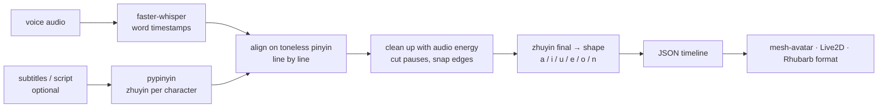

# zh-lipsync

**Mandarin speech → mouth-shape timeline for 2D avatars.** Give it a Chinese voice track, plus subtitles if you have them, and get back a JSON timeline of mouth shapes (`a / i / u / e / o / n`) that follows what is actually being said. It is not driven by volume.

[繁體中文說明 → README.zh-TW.md](README.zh-TW.md)


*Left: the usual volume-based lip sync, which opens and closes the mouth with a random vowel. Right: zh-lipsync, where the shape follows the zhuyin of every syllable. Short clip with sound: [docs/demo/compare.mp4](docs/demo/compare.mp4).*

## Why

- **Most avatar runtimes only get a volume level.** The mouth opens and closes in time, but the shape has nothing to do with the syllable.
- **English tools don't fit Mandarin well.** Tools like Rhubarb Lip Sync are built around English phonemes.
- **What zh-lipsync does instead.** It gets per-syllable timings from [faster-whisper](https://github.com/SYSTRAN/faster-whisper) and reads every character's zhuyin with [pypinyin](https://github.com/mozillazg/python-pinyin). The vowel then picks the mouth shape: 他 → `a`, 是 → `i`, 我 → `o`, 不 → closed lips then `u`.

## Install

```bash
pip install "zh-lipsync[opencc] @ git+https://github.com/Gigi0116/zh-lipsync"   # or, from a clone:  pip install ".[opencc]"
```

- Python 3.9+.
- On the first run, faster-whisper downloads its model (`small`, about 480 MB). After that, `--offline` works.
- `[opencc]` is optional but recommended for Traditional Chinese text. It converts the text before reading polyphones, so 銀行 is read *háng* and 睡覺 is read *jiào*.

## Usage (one line)

```bash
zh-lipsync voice.wav --srt voice.srt -o voice.lipsync.json
```

| input | flag | notes |
|---|---|---|
| subtitles with timings | `--srt subs.srt` or `--lines lines.json` | **Best.** Each line is aligned only to the speech inside its own time range. |
| script without timings | `--text script.txt` | The whole script is aligned at once. |
| nothing | *(no flag)* | The recognizer's own transcript is used. |
| existing word timings | `--words words.json` | Skips Whisper. Save them with `--dump-words` on the first run. |
| other runtimes | `--format rhubarb` | Rhubarb Lip Sync JSON (`A`–`F`, `X`) for tools that already read it. |

The same thing from Python:

```python
from zh_lipsync.core import load_audio, recognize, lipsync, read_srt
audio = load_audio('voice.wav')
timeline = lipsync(audio, recognize(audio), lines=read_srt('voice.srt'))
```

## Output

```json
{
  "format": "zh-lipsync", "version": 1, "duration": 60.0,
  "shapes": ["a", "i", "u", "e", "o", "n"],
  "cues": [ {"t": 0.0, "shape": "n"}, {"t": 0.62, "shape": "a"}, {"t": 0.81, "shape": "i"} ],
  "syllables": [ {"text": "他", "start": 0.62, "end": 0.81, "zhuyin": "ㄊㄚ", "shape": "a", "matched": true} ],
  "matched_ratio": 0.977,
  "timing_error": { "...": "proxy error of the recognizer timings, before and after clean-up" }
}
```

- `cues` holds the timeline.
  - Each shape lasts until the next cue.
  - The timeline always ends closed (`n`).
  - Times are in seconds from the start of the audio.
- `syllables` gives the timing and reading of every syllable, for debugging or captions.

| shape | Zhuyin finals | examples |
|---|---|---|
| `a` wide open | ㄚ ㄢ ㄤ (and ㄞ ㄠ, which split into `a`→`i` / `a`→`o` when long enough) | 他 看 光 在 好 |
| `e` half open | ㄜ ㄝ ㄟ ㄣ ㄥ ㄦ ㄧㄢ ㄩㄢ | 的 人 也 給 先 |
| `i` spread | ㄧ ㄧㄣ ㄧㄥ, and the apical vowel of 是 / 字 / 知 | 一 心 是 |
| `o` round | ㄛ ㄨㄛ ㄡ ㄧㄡ | 我 多 有 就 |
| `u` narrow round | ㄨ ㄩ ㄨㄥ ㄩㄥ ㄩㄣ | 不 去 同 用 |
| `n` closed | silence, pauses, and a short closure before ㄅ ㄆ ㄇ | 媽 不 美 |

## How it works



1. **Align on pinyin, not characters.** Script and recognizer output are matched on toneless pinyin. Traditional vs. simplified text and homophone mis-recognitions (厭證 vs. 驗證) still line up. Unmatched syllables are interpolated over the voiced audio only.
2. **Use the audio to fix the timings.** Recognizers often stretch a word over the pause that follows it, which leaves the mouth open during silence. zh-lipsync measures the audio energy, pulls every syllable back to voiced audio, and uses the punctuation to decide which side of a pause a syllable belongs to. It then snaps pause edges to voiced/unvoiced boundaries and syllable boundaries to energy dips.
3. **Turn readings into shapes.**
   - The zhuyin final picks the shape.
   - ㄅ ㄆ ㄇ close the lips for 2 frames first.
   - Long diphthongs (ㄞ ㄠ) get two shapes.
   - A gap of more than 80 ms between syllables closes the mouth.

## Using it with an avatar

- [`examples/mesh-avatar/`](examples/mesh-avatar/) is a complete page for [mesh-avatar](https://github.com/shinshin86/mesh-avatar-studio) (MIT). It calls `holdMouth(shape)` whenever the shape changes, and volume still drives the head motion.
- [`examples/live2d/`](examples/live2d/) maps each shape to `ParamMouthOpenY` / `ParamMouthForm`, with smoothing.
- [`examples/js/zh-lipsync-player.js`](examples/js/zh-lipsync-player.js) is a dependency-free cue player you can reuse anywhere.

Show each shape about one frame early (`lead: 1/30`). Most runtimes take a frame or two to open the mouth.

## Measured on a real video

A 9-minute narrated video: 1980 syllables, Taiwanese Mandarin, female TTS voice, with `--lines` (timings per line) and the `small` model.

| | |
|---|---|
| syllables matched to the script | 97.7% |
| frames in pauses ≥ 0.2 s with the mouth still open | 29 / 4074 (0.7%); 794 before the pause clean-up |
| recognizer timing error, raw (proxy*) | pause edges: median 60 ms, p90 200 ms; syllable boundaries: median 40 ms, p90 80 ms |
| run time (CPU, `small`, int8) | about 1 min end to end for the 9-minute video, Whisper included; about 4 s when word timings are cached with `--words` |
| playback in Chrome with GPU (mesh-avatar) | 55.6 fps, the display's own rate; 0 dropped frames; mouth opens at −5 ms and closes at +34 ms (median) relative to the audio clock |

\* There are no hand labels. The error is measured against acoustic boundaries: voiced/unvoiced edges and energy dips.

## Known limitations

- **English words.**
  - Acronyms in capitals (CISA, FBI) are spelled letter by letter.
  - Common words (App, Google, iPhone, passkey …) come from a small dictionary, `WORD_SHAPES` in [`zh_lipsync/visemes.py`](zh_lipsync/visemes.py).
  - Any other English word gets a rough guess from its vowel letters.
  - Whether an acronym is spelled out or read as a word is a guess. Unknown all-caps words are spelled; words in `WORD_SHAPES` are read as words.
  - On the demo video (a TTS voice) every acronym was checked against the audio. CISA, FBI, MFA and NIST were spelled out, and SIM and FIDO were read as words, which matches the defaults. Other voices may differ: people often say NIST as one word.
  - Add your own vocabulary to `WORD_SHAPES`.
- **Fast speech.**
  - No shape lasts less than 2 frames at 30 fps. At more than about 6 syllables per second, short syllables merge into their neighbours.
  - Diphthongs are split only when a syllable lasts at least 0.2 s.
- **Short pauses.** Pauses of about 0.2–0.35 s can still leave the mouth open for a few frames.
- **Recognizer timings.**
  - Without subtitles, one recognition error can move a few syllables.
  - Subtitles with line timings help the most.
- **Clean voice only.** The pause clean-up uses audio energy, so background music or noise under the voice makes it less reliable. Use the dry voice track.
- **Only as distinct as your drawings.** On the demo character, `i`, `e` and closed look almost the same at full size, so those changes are hard to see. If you can, draw `i` with a visibly wider opening.
- **Mandarin only.** It does not handle Cantonese or Taiwanese Hokkien.
- **Six shapes are an approximation.** ㄜ, ㄦ and ㄟ all become "half open". If your avatar has more mouth drawings, map `syllables[].zhuyin` yourself.
- **Not real-time.** The tool needs the whole audio file first. A live TTS stream needs timings from the TTS engine.

## Development

```bash
python -m unittest discover -s tests      # no model download needed
```

## License

Made by **Starfish Studio**.

- **Code:** MIT. See [LICENSE](LICENSE).
- **Dependencies:**
  - faster-whisper: MIT.
  - pypinyin: MIT.
  - NumPy: BSD-3-Clause.
  - OpenCC (optional): Apache-2.0.
- **Demo media:** The character in `docs/demo/` is an original character of Starfish Studio. It is there for demonstration only and is **not** covered by the MIT license.
