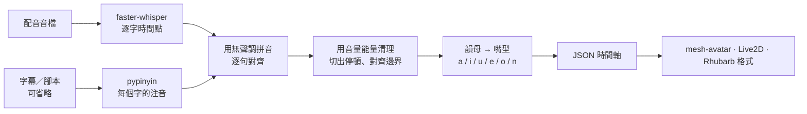

# zh-lipsync

**中文語音 → 2D 角色的嘴型時間軸。** 給它一段中文配音，有字幕更好。它輸出 JSON 嘴型時間軸（`a / i / u / e / o / n`），嘴型跟著實際唸的字走，不是跟著音量。

[English → README.md](README.md)


*左：常見的音量對嘴，嘴巴開合跟得上，但母音是隨機挑的。右：zh-lipsync，每個字照注音決定嘴型。有聲音的短片：[docs/demo/compare.mp4](docs/demo/compare.mp4)。*

## 為什麼做這個

- **大部分角色播放器只拿得到音量。** 嘴巴開合跟得上聲音，但嘴型跟字對不上。
- **英文工具不適合中文。** 像 Rhubarb Lip Sync 這類工具是照英文音素設計的。
- **zh-lipsync 的做法。** 先用 [faster-whisper](https://github.com/SYSTRAN/faster-whisper) 取得每個字的時間，再用 [pypinyin](https://github.com/mozillazg/python-pinyin) 讀出每個字的注音，最後由韻母決定嘴型：他 → `a`、是 → `i`、我 → `o`、不 → 先閉嘴再 `u`。

## 安裝

```bash
pip install "zh-lipsync[opencc] @ git+https://github.com/Gigi0116/zh-lipsync"   # 或在 clone 下來的資料夾裡：pip install ".[opencc]"
```

- 需要 Python 3.9 以上。
- 第一次執行時，faster-whisper 會下載模型（預設 `small`，約 480MB）。之後可以加 `--offline`。
- `[opencc]` 可以不裝，但繁體文字建議裝。它會先轉換文字再判讀多音字，讓「銀行」唸 ㄏㄤˊ、「睡覺」唸 ㄐㄧㄠˋ。

## 用法（一行）

```bash
zh-lipsync voice.wav --srt voice.srt -o voice.lipsync.json
```

| 輸入 | 參數 | 說明 |
|---|---|---|
| 有時間的字幕 | `--srt subs.srt` 或 `--lines lines.json` | **最準。** 每一句只對自己時間範圍內的聲音。 |
| 沒有時間的腳本 | `--text script.txt` | 整段一起對齊。 |
| 什麼都沒有 | （不加參數） | 直接用語音辨識的結果當腳本。 |
| 現成的逐字時間點 | `--words words.json` | 不跑 Whisper。第一次執行時可以用 `--dump-words` 存下來。 |
| 給其他工具用 | `--format rhubarb` | 輸出 Rhubarb Lip Sync 格式（`A`–`F`、`X`）。 |

在 Python 裡用：

```python
from zh_lipsync.core import load_audio, recognize, lipsync, read_srt
audio = load_audio('voice.wav')
timeline = lipsync(audio, recognize(audio), lines=read_srt('voice.srt'))
```

## 輸出格式

```json
{
  "format": "zh-lipsync", "version": 1, "duration": 60.0,
  "shapes": ["a", "i", "u", "e", "o", "n"],
  "cues": [ {"t": 0.0, "shape": "n"}, {"t": 0.62, "shape": "a"}, {"t": 0.81, "shape": "i"} ],
  "syllables": [ {"text": "他", "start": 0.62, "end": 0.81, "zhuyin": "ㄊㄚ", "shape": "a", "matched": true} ],
  "matched_ratio": 0.977,
  "timing_error": { "...": "語音辨識時間點的誤差估計（處理前、處理後）" }
}
```

- `cues` 是時間軸：
  - 每個嘴型維持到下一個 cue。
  - 時間軸最後一定是閉嘴（`n`）。
  - 時間以音檔開頭起算，單位是秒。
- `syllables` 是每個字的時間和讀音，除錯或做字幕都用得到。

| 嘴型 | 韻母 | 例字 |
|---|---|---|
| `a` 大開 | ㄚ ㄢ ㄤ（ㄞ、ㄠ 夠長時切成 `a`→`i`、`a`→`o`） | 他 看 光 在 好 |
| `e` 微開 | ㄜ ㄝ ㄟ ㄣ ㄥ ㄦ ㄧㄢ ㄩㄢ | 的 人 也 給 先 |
| `i` 扁 | ㄧ ㄧㄣ ㄧㄥ，以及「是／字／知」的舌尖音 | 一 心 是 |
| `o` 圓 | ㄛ ㄨㄛ ㄡ ㄧㄡ | 我 多 有 就 |
| `u` 小圓 | ㄨ ㄩ ㄨㄥ ㄩㄥ ㄩㄣ | 不 去 同 用 |
| `n` 閉嘴 | 停頓、靜音，以及 ㄅ ㄆ ㄇ 開頭前的短暫閉唇 | 媽 不 美 |

## 原理



1. **用拼音對齊，不用字。** 腳本和辨識結果都換成無聲調拼音再比對。所以繁簡不同、同音的錯字（厭證／驗證）也對得上。對不上的字，只鋪在有聲音的地方。
2. **用聲音修正時間。** 語音辨識常把停頓算進前後的字，結果停頓時嘴還開著。zh-lipsync 量音檔的能量，把每個字收回有聲的範圍。字放在停頓的哪一邊，看標點決定。最後把停頓邊界對齊有聲／無聲的交界，字和字的交界對齊能量谷底。
3. **讀音轉嘴型。**
   - 韻母決定嘴型。
   - ㄅㄆㄇ 開頭先閉嘴 2 格。
   - ㄞ、ㄠ 字夠長時切成兩段。
   - 字和字之間空隙超過 80ms 就閉嘴。

## 接到角色上

- [`examples/mesh-avatar/`](examples/mesh-avatar/)：[mesh-avatar](https://github.com/shinshin86/mesh-avatar-studio)（MIT）的完整頁面。嘴型換了才呼叫 `holdMouth(shape)`，音量照舊帶動點頭。
- [`examples/live2d/`](examples/live2d/)：把嘴型換成 `ParamMouthOpenY`／`ParamMouthForm`，附平滑處理。
- [`examples/js/zh-lipsync-player.js`](examples/js/zh-lipsync-player.js)：不需要任何依賴的時間軸播放器，哪裡都能用。

建議把嘴型提前約 1 格送出（`lead: 1/30`）。多數播放器張嘴要 1～2 格才到位。

## 實測（一支真的影片）

- 9 分鐘的中文旁白，共 1980 個字。
- 台灣口音的女聲 TTS。
- 使用 `--lines`（每句的時間）和 `small` 模型。

| | |
|---|---|
| 字對上腳本 | 97.7% |
| 0.2 秒以上的停頓裡，嘴還開著的格數 | 29 / 4074（0.7%）；沒做停頓處理時是 794 |
| 語音辨識原始時間誤差（替代基準*） | 停頓邊界：中位數 60ms、p90 200ms。字和字交界：中位數 40ms、p90 80ms |
| 執行時間（CPU，`small`，int8） | 9 分鐘的片子含 Whisper 從頭到尾約 1 分鐘；用 `--words` 讀現成逐字時間點時約 4 秒 |
| Chrome（GPU）播放（mesh-avatar） | 55.6fps，等於螢幕刷新率；掉格 0。以音檔時鐘計，張嘴 -5ms、閉嘴 +34ms（中位數） |

\* 沒有人工逐字標註。誤差是拿聲學邊界來比：有聲／無聲的交界，以及能量谷底。

## 已知限制

- **英文單字：**
  - 全大寫縮寫（CISA、FBI）逐字母唸。
  - 常見單字（App、Google、iPhone、passkey…）查小字典，在 [`zh_lipsync/visemes.py`](zh_lipsync/visemes.py) 的 `WORD_SHAPES`。
  - 其他英文字只能照母音字母粗估。
  - 自己的常用字請加進字典。縮寫到底是逐字母唸還是整個字唸，是用猜的。
- **語速很快時：**
  - 每個嘴型至少 2 格（30fps）。每秒超過約 6 個字時，短的字會併進前後的字。
  - 雙母音要字長 ≥0.2 秒才切兩段。
- **很短的停頓：** 0.2～0.35 秒左右的停頓，還是可能有幾格嘴沒閉完。
- **語音辨識的時間：**
  - 沒有字幕時，一個辨識錯誤可能讓幾個字錯位。
  - 給有時間的字幕效果最好。
- **只適合乾淨的人聲：** 停頓處理靠能量判斷。人聲底下有配樂或雜音時會變不準，請用純人聲音軌。
- **只支援普通話：** 不支援粵語、台語。
- **6 種嘴型只是近似：** ㄜ、ㄦ、ㄟ 都歸成「微開」。如果你的角色有更多嘴型圖，可以讀 `syllables[].zhuyin` 自己對應。
- **不是即時的：** 要先有整個音檔。即時 TTS 需要 TTS 引擎自己提供時間點。

## 開發

```bash
python -m unittest discover -s tests      # 不需要下載模型
```

## 授權

- **程式碼：** MIT，見 [LICENSE](LICENSE)。
- **依賴套件：**
  - faster-whisper：MIT。
  - pypinyin：MIT。
  - NumPy：BSD-3-Clause。
  - OpenCC（選用）：Apache-2.0。
- **示範素材：** `docs/demo/` 裡的角色是本專案作者的原創角色，只供示範，**不**在 MIT 授權範圍內。
